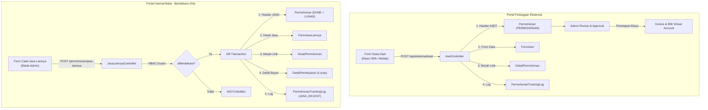

# 🏗️ Arsitektur Modul: Pengajuan Sewa Aset & Pencatatan Jasa Lainnya (PNBP)

> **Repositori:** `private-polimer` (Branch `polimer_v2`)  
> **Status:** ✅ Selesai Diimplementasikan  
> **Tanggal:** 08 Oktober 2026  
> **Target Pengguna:**  
> - **Pengajuan Sewa Aset:** Pelanggan Publik / Eksternal (Perorangan & Perusahaan)  
> - **Jasa Lainnya:** Khusus Bendahara Penerimaan (Internal Balai)  

---

## 1. Latar Belakang & Ruang Lingkup

BBSPJIKKP memiliki aset fisik dan fasilitas yang dapat dimanfaatkan oleh masyarakat dan industri melalui mekanisme sewa, serta penerimaan PNBP dari pos pendapatan jasa lainnya non-layanan utama.

Untuk mengakomodasi kebutuhan tersebut, dibangun 2 (dua) modul terpisah:

1. **Pengajuan Sewa Aset (Eksternal / Pelanggan)**  
   Memungkinkan pemohon memilih kategori sewa aset melalui portal pelanggan, menyertakan durasi dan keperluan, mengunggah berkas pendukung, serta mengikuti alur persetujuan admin balai dan penerbitan Virtual Account (BNI).
2. **Pencatatan Jasa Lainnya (Internal / Khusus Bendahara)**  
   Memfasilitasi Bendahara Penerimaan untuk langsung mencatat transaksi penerimaan PNBP non-layanan utama (misalnya sewa kantin/kios, royalti, atau jasa ad-hoc) tanpa melalui alur verifikasi berkas publik. Status langsung tercatat **SELESAI (DONE)** dan **LUNAS**.

---

## 2. Diagram Alur & Arsitektur



---

## 3. Skema Basis Data

### 3.1 Tabel `form_aset`

Tabel penyimpan rincian pemanfaatan dan sewa aset milik balai:

```sql
CREATE TABLE form_aset (
    id CHAR(36) PRIMARY KEY,
    permohonan_id CHAR(36) NOT NULL,
    jenis_sewa VARCHAR(50) NOT NULL COMMENT 'sewa_lapangan, sewa_bangunan, sewa_alat, sewa_mobil, sewa_ruangan',
    tanggal_mulai DATE NOT NULL,
    tanggal_selesai DATE NOT NULL,
    durasi_hari INT DEFAULT 1,
    keperluan_penggunaan TEXT NOT NULL,
    catatan_tambahan TEXT NULL,
    pemohon_nama VARCHAR(255) NOT NULL,
    pemohon_nik_nib VARCHAR(50) NULL,
    pemohon_alamat TEXT NULL,
    pemohon_telepon VARCHAR(50) NULL,
    pemohon_email VARCHAR(255) NULL,
    file_surat_permohonan VARCHAR(500) NULL,
    setuju_pernyataan BOOLEAN DEFAULT FALSE,
    pernyataan_at TIMESTAMP NULL,
    created_at TIMESTAMP NULL,
    updated_at TIMESTAMP NULL,
    deleted_at TIMESTAMP NULL,
    FOREIGN KEY (permohonan_id) REFERENCES permohonan(id) ON DELETE CASCADE
);
```

### 3.2 Tabel `form_jasa_lainnya`

Tabel pencatatan penerimaan jasa lainnya yang diisi langsung oleh Bendahara:

```sql
CREATE TABLE form_jasa_lainnya (
    id CHAR(36) PRIMARY KEY,
    permohonan_id CHAR(36) NOT NULL,
    pelanggan_nama VARCHAR(255) NOT NULL,
    jenis_pelanggan VARCHAR(50) NOT NULL COMMENT 'perorangan, perusahaan, instansi_pemerintah, lembaga_organisasi',
    negara VARCHAR(100) DEFAULT 'Indonesia',
    provinsi_id VARCHAR(50) NULL,
    provinsi_nama VARCHAR(255) NULL,
    kabupaten_id VARCHAR(50) NULL,
    kabupaten_nama VARCHAR(255) NULL,
    uraian TEXT NOT NULL,
    total DECIMAL(15,2) DEFAULT 0,
    tgl_bayar DATE NOT NULL,
    dicatat_oleh CHAR(36) NULL,
    created_at TIMESTAMP NULL,
    updated_at TIMESTAMP NULL,
    deleted_at TIMESTAMP NULL,
    FOREIGN KEY (permohonan_id) REFERENCES permohonan(id) ON DELETE CASCADE
);
```

---

## 4. Pola & Konvensi Teknis

| Parameter | Pengajuan Sewa Aset | Pencatatan Jasa Lainnya |
|-----------|---------------------|-------------------------|
| **Format Nomor** | `0001/ASET/{BulanRomawi}/{Tahun}` | `0001/JASA/{BulanRomawi}/{Tahun}` |
| **Model Formable** | `App\Models\Db2\FormAset` | `App\Models\Db2\FormJasaLainnya` |
| **Polymorphic Link** | `DetailPermohonan` (`formable_type` = `FormAset`) | `DetailPermohonan` (`formable_type` = `FormJasaLainnya`) |
| **Lingkup Layanan** | `sewa-aset` (Jenis: `aset`) | `jasa-lainnya` (Jenis: `jasa-lainnya`) |
| **Status Awal** | `status_workflow: PERMOHONAN`, `status_bayar: BELUM` | `status_workflow: DONE`, `status_bayar: LUNAS` |
| **Otorisasi (RBAC)** | Pelanggan Login (Owner validation anti-IDOR) | `SysGroup::BENDAHARA` atau `SysGroup::ROOT` |
| **Milestone Log** | `PERMOHONAN_MASUK`, `PERMOHONAN_DIAJUKAN_ULANG` | `JASA_DICATAT` |
| **Pembayaran** | Penetapan penawaran biaya + Invoice + BNI VA | Otomatis dibuat `DetailPembayaran` lunas |

---

## 5. Rincian API & Routing

### 5.1 Endpoint Pengajuan Sewa Aset (`Modules/Eksternal`)

* `GET /api/eksternal/aset/jenis-sewa`: Mengambil daftar pilihan jenis sewa aset (lapangan, bangunan, alat, mobil, ruangan).
* `POST /api/eksternal/aset`: Menyimpan formulir pengajuan sewa aset baru beserta upload berkas surat pendukung.
* `GET /api/eksternal/aset/{id}`: Menampilkan detail pengajuan dengan proteksi kepemilikan data (anti-IDOR).
* `PUT /api/eksternal/aset/{id}` / `POST /api/eksternal/aset/{id}`: Memperbarui data saat status `DRAFT`, `REVISI`, atau `PERMOHONAN_PERLU_PERBAIKAN`.
* `POST /api/eksternal/aset/{id}/ajukan-ulang`: Mengajukan ulang permohonan setelah pemohon menyelesaikan perbaikan.

### 5.2 Endpoint Jasa Lainnya (`Modules/Permohonan`)

* `GET /permohonan/jasa-lainnya`: Halaman daftar transaksi jasa lainnya (DataTable).
* `GET /permohonan/jasa-lainnya/ajax`: Feed server-side DataTables dengan filter & sorting.
* `GET /permohonan/jasa-lainnya/create`: Form pencatatan jasa lainnya (Bendahara only).
* `POST /permohonan/jasa-lainnya`: Eksekusi pencatatan dengan transaksi database lengkap (Bendahara only).
* `GET /permohonan/jasa-lainnya/{id}`: Halaman detail transaksi dan riwayat log.
* `GET /permohonan/jasa-lainnya/{id}/edit`: Form perbaikan/edit pencatatan (Bendahara only).
* `PUT /permohonan/jasa-lainnya/{id}`: Update transaksi dan sinkronisasi perubahan total ke permohonan header & pembayaran.
* `DELETE /permohonan/jasa-lainnya/{id}`: Soft delete pencatatan (Bendahara only).

---

## 6. Integrasi Admin Balai

1. **Admin DataTable Layanan (`PermohonanController@datatable` & `datatableBendahara`):**
   - Eager-loading relasi `formAset` dan `formJasaLainnya`.
   - Resolusi kolom `user` mengenali `pemohon_nama` (Aset) dan `pelanggan_nama` (Jasa Lainnya).
   - Mapping kolom `layanan` mengenali prefix `ASET` sebagai **"Sewa Aset"** dan prefix `JASA` sebagai **"Jasa Lainnya"**.
2. **Approval & Bulk Approve (`PermohonanController@approve` & `bulkApprove`):**
   - Otomatis memetakan nama item bayar menjadi `Biaya Sewa Aset ({no_permohonan})` dan `Jasa Lainnya ({no_permohonan})`.
   - Resolusi data pemohon (nama, alamat, email, telepon) untuk pembuatan BNI Virtual Account & invoice PDF.
3. **Detail Layanan (`detail.blade.php`):**
   - Menambahkan routing component ke `forms/aset.blade.php`.
   - Menampilkan kartu ringkasan sewa, periode, durasi, identitas pemohon, berkas surat permohonan (dengan tombol preview modal & unduh), serta status pernyataan integritas.
