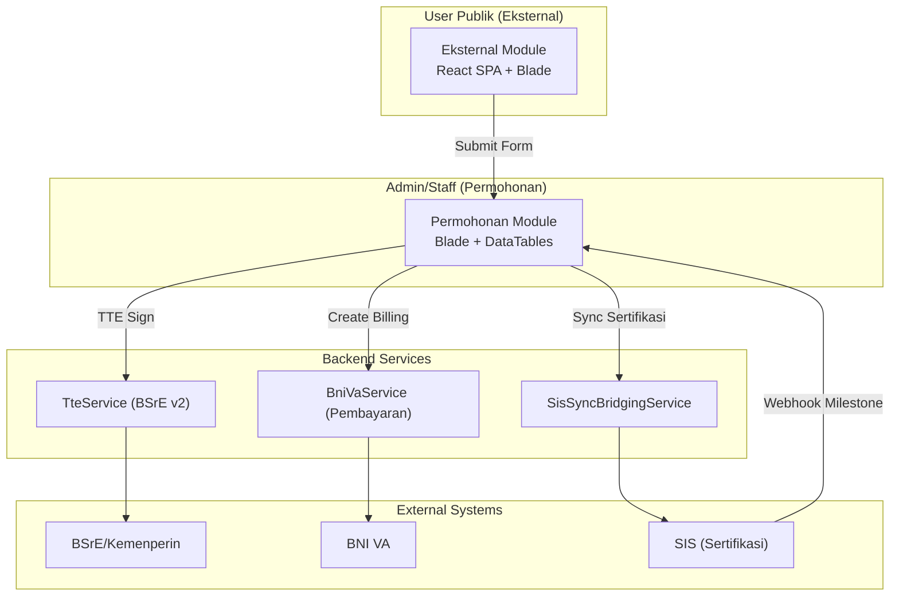
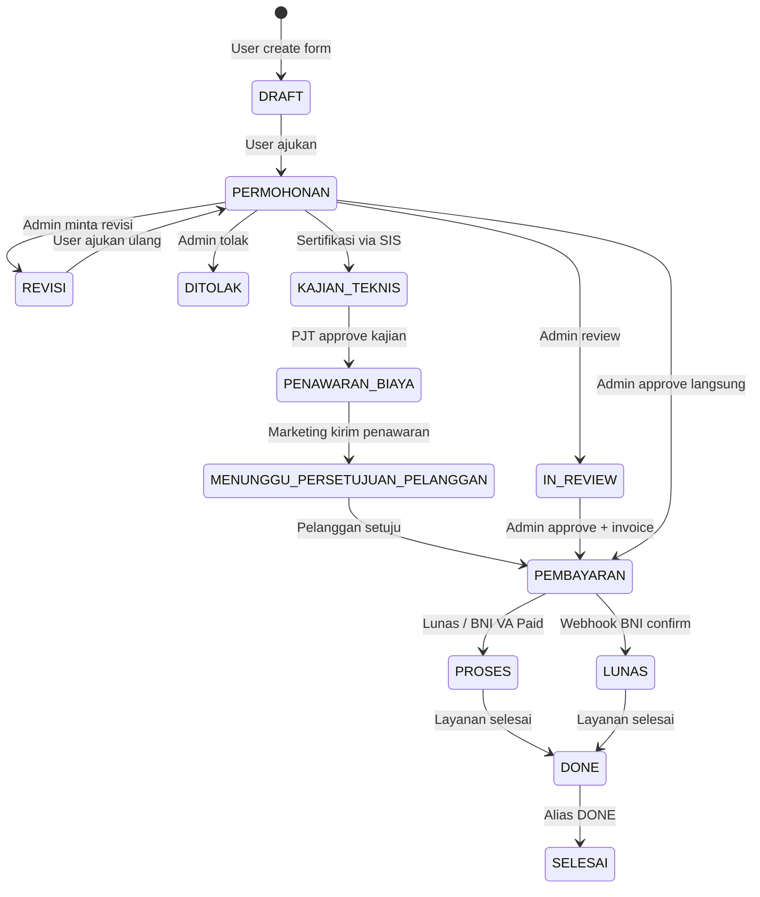

# 🔍 Implementation Plan & Framework: Audit Seluruh Flow Pengajuan/Permohonan Polimer

> **Tujuan:** Memastikan semua flow permohonan berjalan end-to-end tanpa bug, tanpa flow terputus,
> dengan keamanan data dan kesinambungan flow acc/approval yang benar — baik untuk user publik
> (perorangan/perusahaan) maupun internal (karyawan/admin/bendahara/marketing).  
> **Status:** Dieksekusi & Terverifikasi (Lihat [Laporan Audit Alur 11 Layanan](laporan_audit_alur_permohonan_11_layanan_dan_keamanan.md)).

---

## 📋 Daftar Isi

1. [Arsitektur & Peta Flow](#1-arsitektur--peta-flow)
2. [Fase 1 — Audit Flow Submission (User Publik)](#2-fase-1--audit-flow-submission-user-publik)
3. [Fase 2 — Audit Flow Internal (Admin/Marketing/Bendahara)](#3-fase-2--audit-flow-internal-adminmarketingbendahara)
4. [Fase 3 — Audit Keamanan & Data Integrity](#4-fase-3--audit-keamanan--data-integrity)
5. [Fase 4 — Audit Integrasi Eksternal](#5-fase-4--audit-integrasi-eksternal)
6. [Fase 5 — Regression & Edge Case Testing](#6-fase-5--regression--edge-case-testing)
7. [Fase 6 — Penyusunan Laporan Audit Komprehensif (Deliverables)](#7-fase-6--penyusunan-laporan-audit-komprehensif-deliverables)

---

## 1. Arsitektur & Peta Flow

### 1.1 Module Map

### 1.2 Daftar Layanan & Prefix Permohonan

| No | Layanan | Prefix `no_permohonan` | Form Model | User-Facing Controller |
|----|---------|----------------------|------------|----------------------|
| 1 | Sertifikasi Produk & Sistem (LSPro) | `CERT`, `SRT` | `FormSertifikasi` | `SertifikasiController` |
| 2 | Sertifikasi Profesi (LSP) | `LSP` | `FormLsp` | `LSPController` |
| 3 | Pelatihan | `REG`, `UMK`, `TRN` | `FormPelatihan` | `PelatihanController` |
| 4 | Inspeksi Teknis | `INSP`, `INS` | `FormInspeksi` | `InspeksiController` |
| 5 | Sertifikasi Halal (LPH) | `HLL`, `HAL` | `FormHalal` | `HalalController` |
| 6 | Verifikasi GRK | `GRK` | `FormGrkVerifikasi` | `GrkController` |
| 7 | Validasi GRK | `GRK` | `FormGrkValidasi` | `GrkValidasiController` |
| 8 | Pengujian | `UJI` | `FormPengujian` | `PengujianController` |
| 9 | Kalibrasi | `LABKAL` | `FormKalibrasi` | `KalibrasiController` |
| 10 | Miniplant | `PA`, `F`, `MKP`, `RK` | `FormMiniplant` | `MiniplantController` |
| 11 | PUP (Uji Profisiensi) | `UP-` | `FormPup` | `PupController` |

### 1.3 Status Workflow States

### 1.4 Role Map

| Role | Enum | Akses |
|------|------|-------|
| ROOT | `c38771bc-...` | Superadmin, full access |
| ADMIN | `c3877414-...` | Manajemen permohonan, review |
| MARKETING | `c38774b4-...` | Verifikasi awal, penawaran biaya |
| BENDAHARA | `c3877540-...` | Invoice, BNI VA, approval TTE kuitansi |
| PEGAWAI | `c38775cc-...` | Akses internal, penugasan |
| PELANGGAN | `c3877658-...` | User publik (perorangan / perusahaan) |

---

## 2. Fase 1 — Audit Flow Submission (User Publik)

1. **User Perorangan vs Perusahaan:**
   - Memastikan kelengkapan data NIK/NIB, alamat, kontak, dan surat kuasa institusi.
   - Penagihan mandiri vs split bill vs together bill.
2. **Form Draft & Submission Lifecycle:**
   - Uji penyimpanan draft berkala (autosave IndexedDB & server side).
   - Validasi file upload (PDF/gambar, batasan ukuran 5MB-10MB).
   - Penanganan error validasi form tanpa menghilangkan input pengguna.

---

## 3. Fase 2 — Audit Flow Internal (Admin/Marketing/Bendahara)

1. **Dashboard & Verifikasi Permohonan:**
   - Review berkas persyaratan dan penugasan tim evaluator.
   - Pembedaan aksi: Setujui, Minta Revisi, atau Tolak permohonan.
2. **Kajian Teknis & Penawaran Biaya:**
   - Integrasi tarif PNBP sesuai PP No. 54 Tahun 2021.
   - Kirim Surat Pemberitahuan Pembayaran (SPP) / Surat Penawaran Biaya ke pemohon.
3. **Penerbitan Invoice & Pembayaran:**
   - Billing otomatis via BNI e-Collection VA.
   - Pelunasan, approval bendahara, dan pembubuhan TTE Kuitansi resmi.

---

## 4. Fase 3 — Audit Keamanan & Data Integrity

1. **Role-Based Access Control (RBAC):**
   - Enforce batas otorisasi Bendahara vs Petugas umum.
   - Pencegahan pembobolan otorisasi horizontal (IDOR).
2. **Data Privacy & Sanitasi Log:**
   - Masking Nomor Induk Kependudukan (NIK) pada log sistem (`320101******0001`).
   - Larangan pencatatan Passphrase dan TOTP.
3. **Dual-Database Persistence:**
   - Pemeriksaan relasi antar `Db1` dan `Db2`.
   - Pemenuhan whitelist `$fillable` pada model Eloquent `Permohonan`.

---

## 5. Fase 4 — Audit Integrasi Eksternal

1. **BSrE TTE v2:**
   - Pengujian mode online vs mode dummy offline (`TTE_DUMMY=true`).
   - Verifikasi penempatan barcode dan metadata digital.
2. **BNI Virtual Account:**
   - Verifikasi webhook callback dan HMAC signature token.
   - Pencegahan race condition dan double processing tagihan.
3. **SIS Bridging:**
   - Validasi sinkronisasi permohonan sertifikasi industri.
   - Penanganan payload webhook milestone audit tahap 1 dan tahap 2.

---

## 6. Fase 5 — Regression & Edge Case Testing

- **Double Submit Handling:** Mutasi form berbasis database atomic transaction.
- **Bulk Approve Multi-Service:** Dukungan ekspresi match untuk semua prefix layanan tanpa fatal crash.
- **Orphan Records Cleanup:** Cascade delete data terkait pada pembatalan draft permohonan.
- **Notification Routing:** Memastikan link notifikasi publik mengarah ke UI SPA pelanggan.

---

## 7. Fase 6 — Penyusunan Laporan Audit Komprehensif (Deliverables)

Hasil temuan dan eksekusi audit didokumentasikan pada:
- [`laporan_audit_alur_permohonan_11_layanan_dan_keamanan.md`](laporan_audit_alur_permohonan_11_layanan_dan_keamanan.md)
- [`changelog_polimer.md`](../changelog_polimer.md)
- Repository commits: `c367295`, `80b9832`, `e30ac6c`, `8cb376d`, `8ead9d8`.
